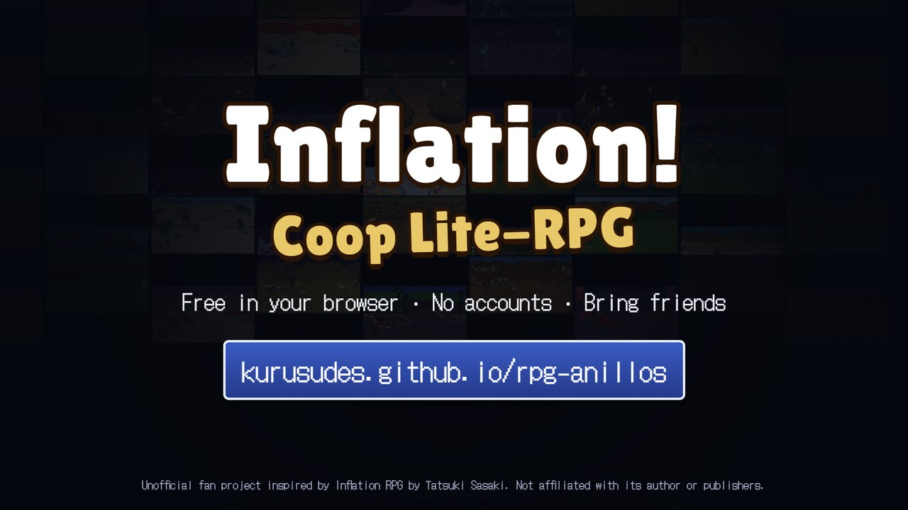
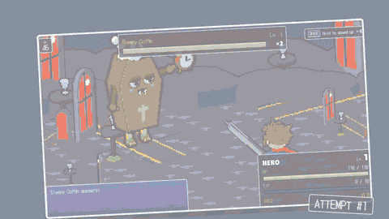
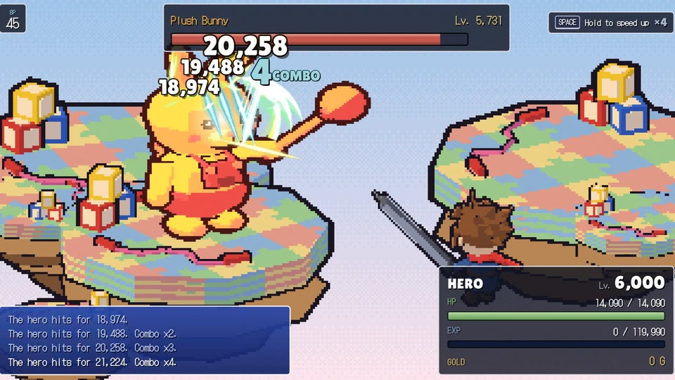
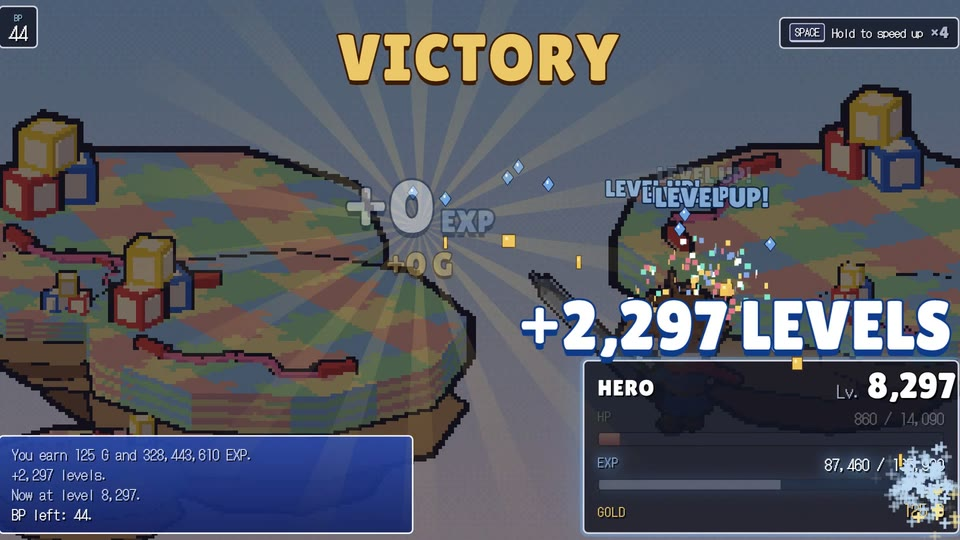
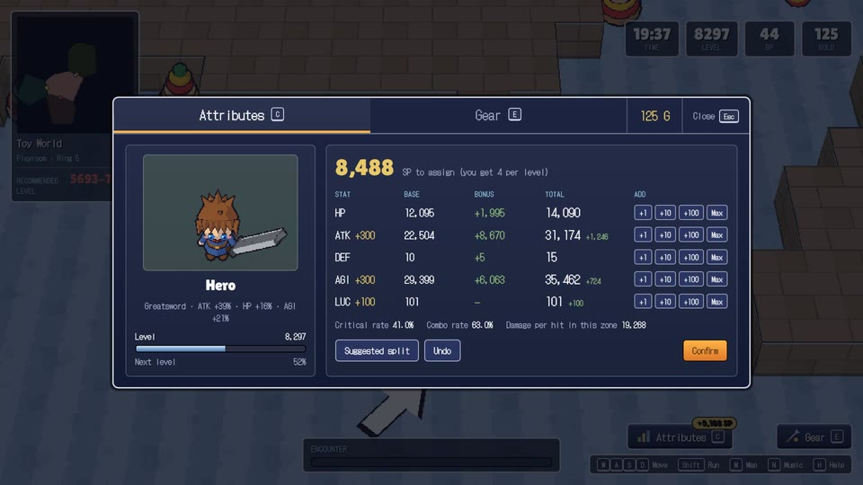
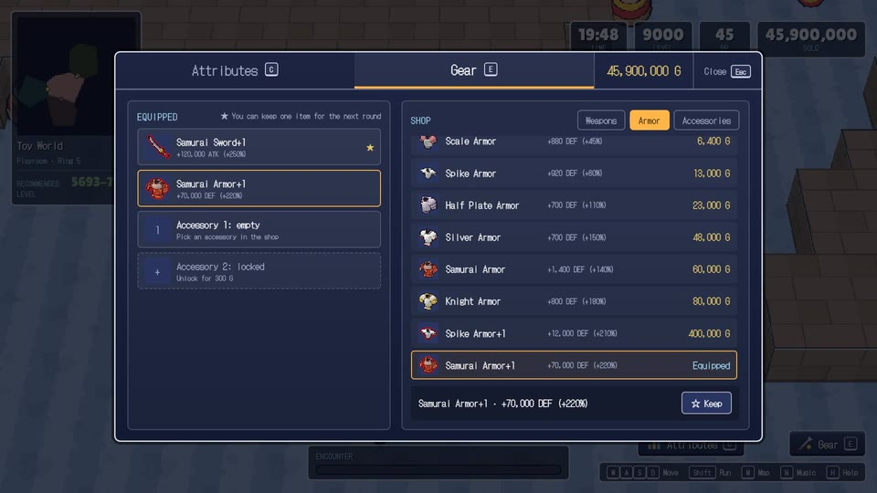
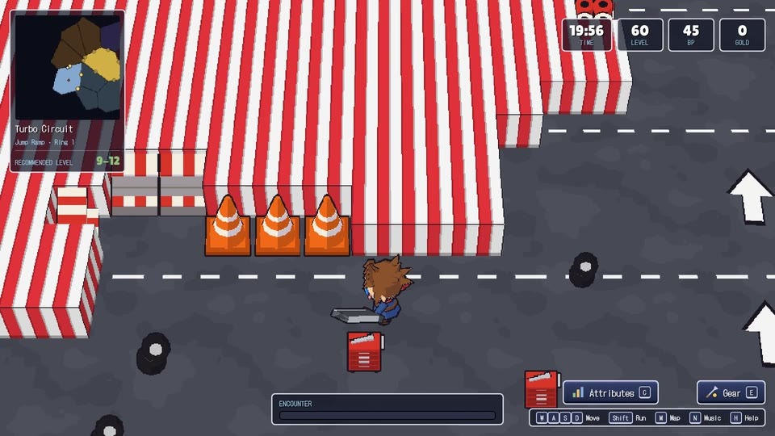
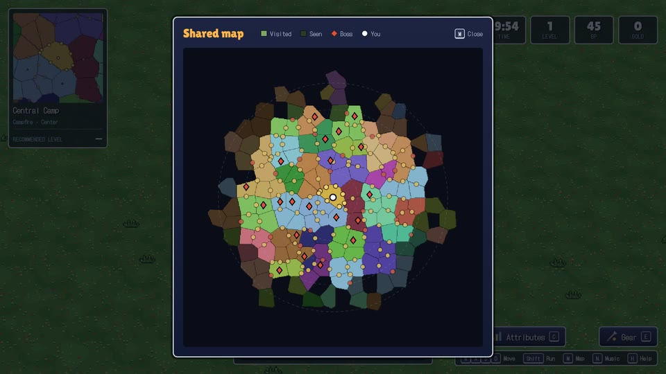
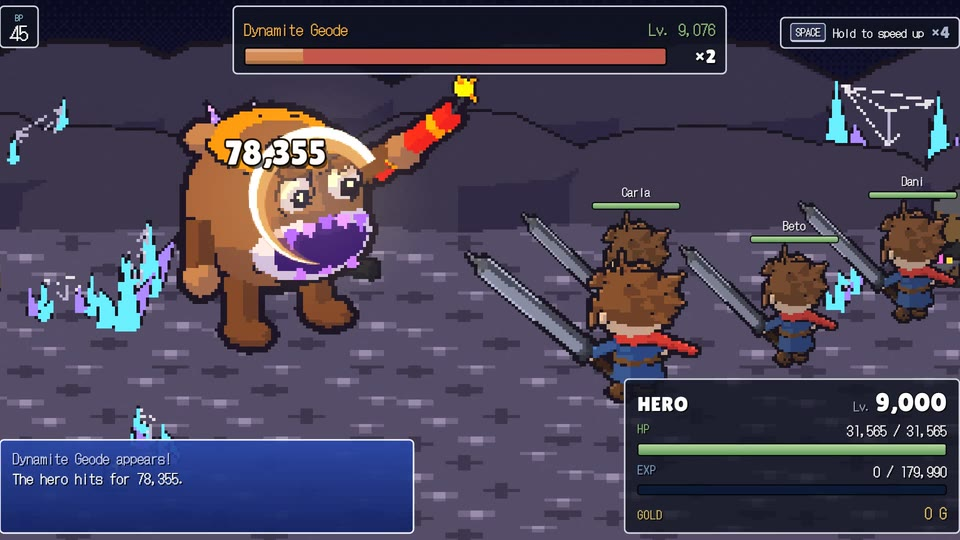
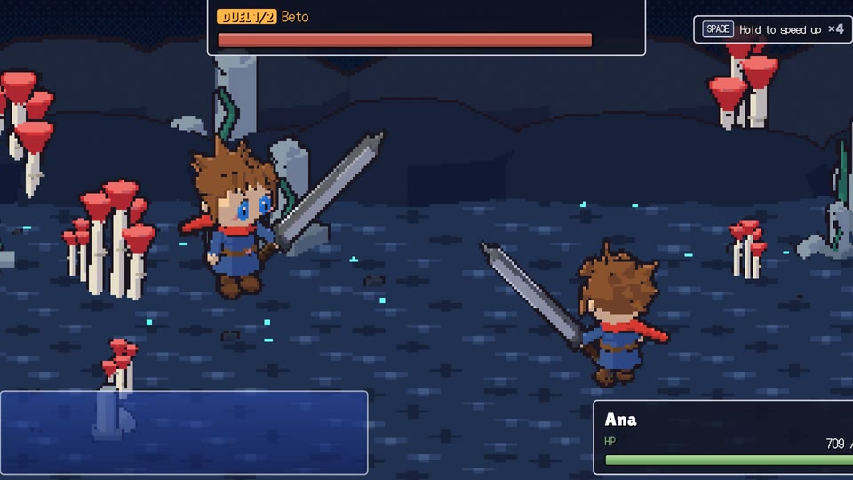

# Inflation! Coop Lite-RPG

*[English](README.md) · Español*

**Un RPG cooperativo e incremental que se juega en el navegador.** Los combates son automáticos. No ganará el primero que importa. Ni el segundo. Pero en cada ronda los combos se alargan, las cifras se vuelven más absurdas y el equipo brilla más, hasta que el anillo que lo aplastó se convierte en su calentamiento. Y lo mejor llega con amigos: exploran el mismo mundo, luchan codo con codo y, entre ronda y ronda, descubren de una vez quién tiene la mejor build.

Gratis, sin anuncios, sin cuentas y sin instalar nada. Se juega en un ordenador con teclado.

| | |
|---|---|
| **Jugar** | https://kurusudes.github.io/rpg-anillos/ |
| **Tráiler (inglés)** | [Ver en el navegador](https://kurusudes.github.io/rpg-anillos/trailer/inflation-coop-trailer-en.mp4) · [MP4](trailer/inflation-coop-trailer-en.mp4) |
| **Idiomas** | Español e inglés (se elige en la pantalla de inicio) |
| **Jugadores** | Solo, o con amigos por internet con un código de sala de cinco letras |

---

## El tráiler

Un tráiler de 70 segundos en motion graphics sobre el bucle. Los combates son automáticos; las decisiones son suyas: adónde ir, cómo armar la build, qué arriesgar. Después se intenta otra vez (y otra), los combos y las cifras se descontrolan, se llega más lejos en cada ronda y aparecen las 270 criaturas y los 42 jefes del mapa por defecto, hasta que algo espera en la oscuridad más allá del sexto anillo. Luego los biomas, los objetos (58 son joyas), los personajes y, lo mejor, los amigos: ¿quién tiene la mejor build?

Cada fotograma es una función pura del reloj, hecha con partidas reales capturadas del juego y con los sprites del propio juego, y grabada fotograma a fotograma. La música chiptune y los efectos de sonido se sintetizan en código y van sincronizados con los cortes.

---

## Capturas

| Combos | Niveles, en plural |
|---|---|
|  |  |
| **Repartir los puntos** | **Tienda y equipo** |
|  |  |
| **Explorando un bioma** | **El mapa compartido** |
|  |  |
| **Luchar juntos** | **Duelos entre rondas** |
|  |  |

---

## El bucle

1. **Empieza la ronda.** Aparece en el campamento del centro del mundo con **nivel 1**, sin oro, un reloj de 20 minutos y **45 puntos de batalla (PB)**.
2. **Camine.** Donde hay criaturas se llena el medidor de encuentro. Cuanto más lleno, más fácil es que empiece un combate.
3. **Luche.** El combate se juega solo: usted mira, y con Espacio o un clic lo acelera. Cada combate cuesta 1 PB (perderlo cuesta 3). Los jefes devuelven PB.
4. **Suba de nivel.** Cada victoria da experiencia. Cada nivel da puntos para repartir entre HP, ATK, DEF, AGI y LUC. Cómo los reparte es su build.
5. **Equípese.** Gaste el oro en la tienda en armas, armaduras y joyas, y confíe en que la tabla de botín quiera a su suerte.
6. **La ronda termina** cuando se acaba el reloj o los PB. El nivel y el oro vuelven a cero. Conserva el mapa descubierto, **un objeto** a su elección y los personajes desbloqueados, y su personaje se hace un poco más fuerte para la próxima.
7. **Otra vez.** Y otra. Cada vez se llega un poco más lejos.

Seis anillos de peligro creciente rodean el campamento. En algún lugar más allá del último espera el motivo de todo esto. No lo vamos a contar. No cae ante un solo jugador.

---

## Características

### Un mundo hecho con una semilla
- **Seis anillos** alrededor de un campamento central, divididos en cientos de zonas (332 en el mapa por defecto) y generados a partir de una semilla: todos los de una sala tienen exactamente el mismo mundo.
- **54 biomas**, cada uno con su suelo, sus props, sus criaturas y su fondo de combate: desde praderas y circuitos de carreras hasta criptas encantadas y selvas alienígenas.
- **270 criaturas** y decenas de jefes (42 en el mapa por defecto), cada uno el más fuerte de su vecindario.
- Un **mapa compartido** que recuerda lo que el grupo ha descubierto, ronda tras ronda. El nivel recomendado de cada zona tiene el color de su riesgo.

### Combates que crecen con usted
- **Combate automático** con combos, críticos y efectos de golpe que se vuelven más vistosos con su poder.
- La vida del enemigo en **barras de colores apiladas** (los jefes no dicen cuántas les quedan).
- Un **cobro estilo tragamonedas** de experiencia, oro y botín al final de cada combate.
- Fórmulas fieles al RPG incremental clásico que lo inspira: las cifras empiezan pequeñas y terminan enormes.

### Equipo, joyas y personajes
- **141 objetos:** 59 armas, 24 armaduras y 58 accesorios (anillos, gemas y collares), muchos con efectos especiales.
- **16 personajes** para desbloquear, uno más por ronda, cada uno con sus inclinaciones.
- Elija qué objeto conserva entre rondas.

### Mejor con amigos
- **Cooperativo en línea** con un código de sala: el navegador del anfitrión ejecuta la partida y los demás se conectan directamente (WebRTC).
- **Combates en grupo:** esperen juntos al lado de un jefe y todos luchan contra él a la vez.
- **Duelos entre rondas:** cada jugador se enfrenta a todos los demás con las estadísticas igualadas, para que gane la mejor build y no la sesión más larga. Corona para el ganador, gloria eterna incluida.
- Si se cae la conexión, puede volver a la sala con su código y su nombre.

### Comodidad
- Español e inglés, una hoja de ayuda (**H**) y la opción "Reducir movimiento" para sacudidas, destellos y partículas.
- Música chiptune y efectos de sonido sintetizados en el navegador.

## Controles

| Tecla | Acción |
|---|---|
| W A S D | Moverse |
| Mayús | Correr |
| Espacio o clic | Acelerar el combate |
| C | Atributos (repartir los puntos) |
| E | Tienda y equipo |
| M | Mapa compartido |
| N | Activar o quitar la música |
| H | Ayuda |

---

## Tecnología

- Escrito en **TypeScript**, empaquetado con **Vite** y servido como sitio estático desde GitHub Pages. No hay servidor de juego ni base de datos: no se guarda nada, ni siquiera en su navegador.
- **Mundo en 3D** con [three.js](https://threejs.org/), y juego en línea por WebRTC con [PeerJS](https://peerjs.com/).
- **Generador de mundos determinista:** cada navegador construye el mismo mapa a partir de la semilla de la sala y lo comprueba con una huella.
- **Simulación con el anfitrión como autoridad**, separada del dibujo y cubierta por pruebas automáticas.
- **Arte hecho en Blender con scripts:** modelos low poly de criaturas, props, objetos y personajes, renderizados con una pasada de pixel art a sprites.

Este repositorio solo aloja el juego compilado. El código fuente vive en otro repositorio, privado.

### Privacidad

Sin cuentas, sin cookies y sin analíticas. Para emparejar a los jugadores, las partidas en línea usan el servidor de señalización público de PeerJS; después, los datos de la partida viajan directamente entre los navegadores. Algunas redes de colegios u oficinas bloquean WebRTC; si una sala no conecta, pruebe con otra red.

---

## Licencia y créditos

El código y los recursos originales están bajo la [licencia MIT](LICENSE) © 2026 Sowtank. Si usa este proyecto o parte de él, se agradece un crédito visible (detalles en [NOTICE.md](NOTICE.md)).

**Proyecto de fans no oficial.** Se inspira en *Inflation RPG*, de Tatsuki Sasaki, y no está afiliado, patrocinado ni aprobado por su autor ni por sus editores. *Inflation RPG* es propiedad de sus respectivos dueños; algunos nombres de objetos, valores de juego y diseños de personajes siguen al original y no están cubiertos por la licencia MIT. Los avisos de terceros (three.js, PeerJS, tipografías) están en [NOTICE.md](NOTICE.md).
